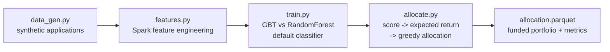

# Loan Allocation ML

Optimize how a fixed pool of capital gets allocated across loan applications using
Spark ML. A gradient-boosted default model scores every application, and a
risk-aware allocation engine funds the best risk-adjusted loans first — the same
shape of problem real lending desks solve, minus the proprietary data.

> **Disclaimer:** This is an educational portfolio project built on **synthetic
> data**. It is not financial advice, and nothing here should be used to make
> real lending or investment decisions.

## The problem

A lender has $10M to deploy and 50,000 loan applications. Funding everything is
impossible, and funding naively (biggest loans first, or highest rate first)
ignores default risk. The goal: maximize expected portfolio return while
respecting per-loan exposure caps and a minimum return hurdle.

## How it works



1. **Generate** — `data_gen.py` creates realistic synthetic applications
   (credit score, income, DTI, loan amount, term, employment, home ownership)
   with default labels driven by known risk relationships.
2. **Engineer** — `features.py` builds a Spark ML pipeline: credit-score
   bucketing, one-hot home ownership, derived ratios (loan-to-income, monthly
   payment share), assembled into a feature vector. The fitted featurizer is
   persisted to avoid train/serve skew.
3. **Train** — `train.py` fits gradient-boosted trees and a random forest,
   evaluates AUC / accuracy / F1 on a holdout set, and keeps the winner.
4. **Allocate** — `allocate.py` scores applications, computes expected return
   per loan (`rate × (1 − p_default) − LGD × p_default`), filters below the
   return hurdle, and funds in descending expected-return order up to the
   per-loan cap until capital is exhausted.

## Tech stack

- **PySpark 3.5** — feature engineering, MLlib training, allocation (all Python)
- **pandas / NumPy** — synthetic data generation
- **scikit-learn** — available for offline experiments
- **Parquet** — all intermediate storage

## Quickstart

```bash
pip install -r requirements.txt

# 1. Generate synthetic applications
python -m src.data_gen --n 50000

# 2. Engineer features
python -m src.features

# 3. Train and pick the best model
python -m src.train

# 4. Allocate $10M of capital
python -m src.allocate --capital 10000000
```

Environment overrides: `SPARK_MASTER`, `TOTAL_CAPITAL`, `N_APPLICATIONS`.

## Model notes

- Target: binary default label. Features are deliberately "honest" — no
  leakage (nothing derived from the outcome).
- Typical holdout AUC on the synthetic data: ~0.80–0.85 for GBT. Your numbers
  will vary with the random seed; the point is the pipeline, not the score.
- Allocation is intentionally greedy and explainable rather than a black-box
  optimizer — easier to reason about in a risk review, and a good starting
  point before moving to constrained optimization.

## Project structure

```
loan-allocation-ml/
├── README.md
├── requirements.txt
├── src/
│   ├── config.py       # settings, env overrides, Spark session
│   ├── data_gen.py     # synthetic loan application generator
│   ├── features.py     # Spark feature engineering pipeline
│   ├── train.py        # GBT vs RF training + evaluation
│   └── allocate.py     # risk-aware capital allocation engine
├── notebooks/
│   └── loan_analysis.ipynb
└── data/ models/       # generated locally, gitignored
```

## Limitations & next steps

- Synthetic data can't capture real-world regime shifts; a production system
  would retrain on vintage curves and macro features.
- The train/test split is random — time-based splitting by origination date
  would be more honest.
- Natural extensions: fairness auditing across applicant segments, LGD
  modeling instead of a fixed haircut, and portfolio-level concentration
  limits by band or geography.

## License

MIT
